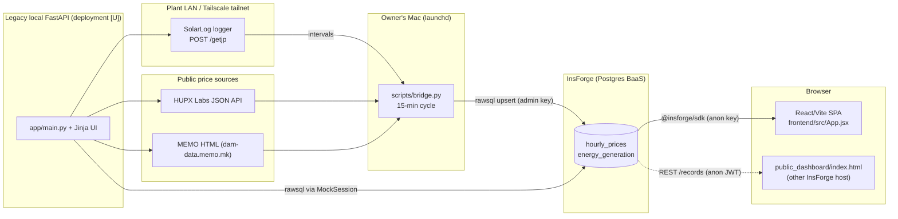
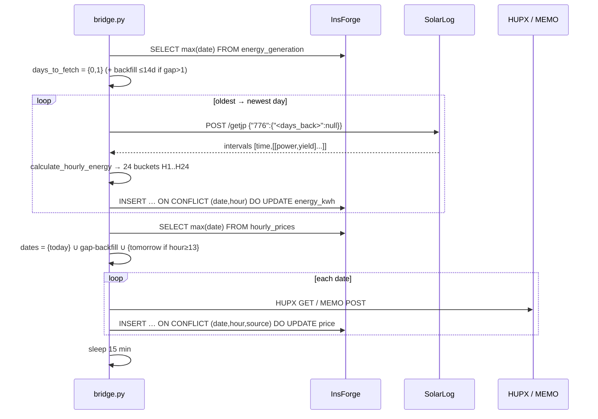
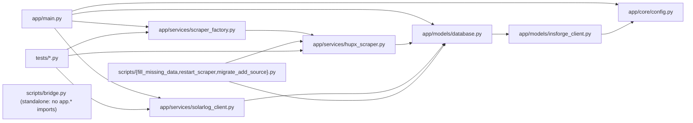

# 02 — Architecture and Data Flow

**Evidence:** all component links traced in source **[V]** unless tagged. Live InsForge state could not be inspected (no credentials used) **[U]**.

## 1. Three coexisting paths

**Production data path (1):** SolarLog + HUPX/MEMO → `bridge.py` → InsForge → React app. **FastAPI (2)** is not in this path; the React app has no `/api` call (`vite.config.js` proxies `/api`→`localhost:8000`, but `App.jsx` never uses it). **(3) SQLite** `hupx_prices.db` is a frozen snapshot.

## 2. Component responsibilities
| Component | Responsibility | Key files |
|---|---|---|
| Bridge | Fetch hardware + prices, compute hourly kWh, upsert to cloud, backfill gaps | `scripts/bridge.py` |
| InsForge Postgres | Single source of stored truth: 2 tables | `scripts/init_schema.sql` |
| React SPA | Query DB, compute revenue/KPIs, render charts/tables | `frontend/src/App.jsx`, `styles.css`, `index.css` |
| public_dashboard | Alternate standalone dashboard (vanilla JS) | `frontend/public_dashboard/index.html` |
| FastAPI | REST + Jinja UI + background scrapers/energy fetch (legacy) | `app/main.py` |
| `EnergyDataService` | Legacy hardware client + hourly calc + DB save | `app/services/solarlog_client.py` |
| Scrapers | HUPX/MEMO price retrieval + DB save | `app/services/hupx_scraper.py`, `scraper_factory.py` |
| MockSession | SQLAlchemy-shaped shim over InsForge raw SQL | `app/models/database.py`, `insforge_client.py` |

## 3. Production flow, step by step (one bridge cycle) **[V]**

Read side: browser → `insforge.database.from('hourly_prices'|'energy_generation')` with `eq/gte/lte` filters → client-side `useMemo` aggregation (`App.jsx` L285–413) → Chart.js. Auto-refresh every 5 min (`App.jsx` L273–282).

## 4. Legacy FastAPI flow **[V]**
Startup: build scraper (`ScraperFactory`), `EnergyDataService`, mount `/static`, three background loops (see doc 03). Request `/api/analysis/by-date/{date}`: (a) calls hardware for that day and writes energy rows, (b) reads energy + price rows via `MockSession` raw SQL, (c) if no prices → scrape (which writes to DB) and re-read, (d) compute totals in Python. This **read endpoint triggers hardware I/O and DB writes** (`main.py` L467).

## 5. Time and date model
- Dates are calendar dates (`DATE`), hours are labels; **no timestamps or time zones are stored**. Bridge dates come from the Mac's local clock (`datetime.now()`); SolarLog interval times are device-local; HUPX delivery day is market time (CET/CEST). All assumed to be the same zone **[I]**.
- DST breaks the 24-label model: 25-hour day (HUPX returns `ProductH` like `3A/3B`) crashes HUPX parsing (R-D3); 23-hour day behaviour **[U]**.

## 6. Dependency / impact map
| If this changes… | These break or change |
|---|---|
| SolarLog `/getjp` payload keys (`776`), interval shape, timestamp format | `calculate_hourly_energy`, `EnergyDataService.get_hourly_data`, `_discover_device` probe (`777`) → no new energy rows; dashboard shows stale/zero energy |
| Meaning of cumulative counters (resets, units) | Hourly energy in **all** history after change; revenue; monthly totals |
| `energy_generation` / `hourly_prices` columns or PK | bridge `upsert` SQL, `database.py` inserts (`id` column!), React `select('*')`, `public_dashboard`, `ON CONFLICT` targets |
| `hour` label format (`H1..H24`) | Every reader's join key (React `hourlyMap`, FastAPI `hour_to_number`, dashboards, scrapers) |
| `source` values (`hupx`,`memo`) | Source dropdowns in React/legacy UI, scrapers' `source` field, `eq('source', …)` filters |
| HUPX JSON field names (`DeliveryDay`,`ProductH`,`Price`) or API granularity | Both scrapers; day with parse error ⇒ no HUPX rows ⇒ revenue 0 for that source/day |
| MEMO HTML table layout (3rd table, date headers `DD.MM.YYYY`, `€` unit rows) | MEMO scrapers (bridge + FastAPI) |
| InsForge URL/keys/RLS/grants | Bridge writes (401 outage on 2026-11-02), React reads, FastAPI (`.insforge/project.json`) |
| Tailscale hostname/ports/IPs | `SOLARLOG_CANDIDATES`, `.device_cache`, `ensure_tailscale()`; hardware reachability |
| `styles.css` tokens/classes | React app **and** Jinja templates (shared file, duplicated copy) |
| Revenue formula or averaging rule | Must change in `main.py` (2 endpoints), `App.jsx`, `public_dashboard` together |
| Price missing (scraper down) | Revenue 0 + diluted average (React), 404/empty (legacy) — no alert |
| Hardware unreachable | Bridge logs discovery failures, skips upsert; dashboard stale, no staleness UI |
| DB has incomplete day | React shows partial; monthly counts day only if any energy row exists |

## 7. Configuration that must match across components
- `hour`/`source`/`date` conventions (above).
- InsForge project identity: bridge `INSFORGE_URL`, React `VITE_INSFORGE_URL`, FastAPI `.insforge/project.json`, `public_dashboard` hard-coded host (**different host**, [U]).
- Port expectations: Vite proxy → `:8000`; Dockerfile → `:8080`; Railway → `$PORT`.
- Device candidates in `bridge.py` (`SOLARLOG_CANDIDATES`) vs `ENERGY_DEVICE_*` in `config.py`/`.env`.

## 8. Module import graph (generated from the AST, 2026-11-03) **[V]**

Third-party imports per module (AST): `main.py` → fastapi, fastapi_utils, requests · `config.py` → pydantic_settings · `database.py` → sqlalchemy (only `IntegrityError`) · `insforge_client.py` → requests · `solarlog_client.py` → requests, sqlalchemy · `hupx_scraper.py` → bs4, pandas, requests · **`bridge.py` → bs4, python-dotenv, requests** (no `app.*` import). Implications: the bridge shares **no code** with FastAPI (changing `app/` cannot affect production ingestion, and vice versa); `insforge_client.py` reads `.insforge/project.json` at import, so *every* `app.*` import chain that reaches `database.py` (main, both services, scripts, tests) fails without that file. The 3-package `requirements.txt` equals the bridge's imports exactly (see 10 §3).
