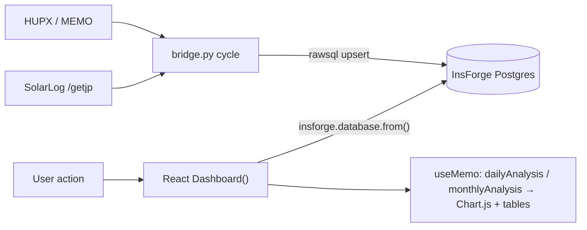

# 09 — Application Features and Workflows (feature → code map)

**Evidence:** every row traced through source **[V]**. Only features that exist are listed; §4 lists notable things that do **not** exist.
Chain notation: **Feature → Frontend → JS logic → API/DB call → Backend route → Service → DB → External**.
Primary UI = React SPA (`frontend/src/App.jsx`, line refs are for that file unless noted).

## 1. User-facing features (React SPA — production UI)
| # | Feature | Where in UI | Logic (App.jsx) | Data call → table | Backend/route | External | Look here before changing |
|---|---|---|---|---|---|---|---|
| F1 | **Daily analysis** (24-hour production, price, revenue, KPIs) | Daily tab; `sl-kpi-grid`, chart card, table card (L744–997) | `fetchDaily` L195, `dailyAnalysis` L285–331, `dailyChartData` L416, `chartOptions` L500 | `hourly_prices` (`eq date`, `eq source`) + `energy_generation` (`eq date`) | none (direct to InsForge) | InsForge | [05 §6–7](05_SOLAR_DOMAIN_AND_CALCULATIONS.md); mirror `main.py::get_price_energy_analysis` & `public_dashboard::calcSummary` |
| F2 | **Monthly overview** (per-day totals, month KPIs) | Monthly tab (L790–1000) | `fetchMonthly` L226, `monthlyAnalysis` L334–413, `monthlyChartData` L457 | `hourly_prices` and `energy_generation` with `gte/lte date`, `limit(5000)` | none | InsForge | same; month day-count & `Avg. Spot Price` label |
| F3 | **Date selection & navigation** | ◀ date input ▶ (L644–667) | `handlePrevDay/NextDay` L158–170 (**bug R-F1**), `initLatest` L173 picks newest `energy_generation.date` | `energy_generation` order date desc limit 1 | none | InsForge | timezone-safe date math; [08 §2](08_FRONTEND_AND_DESIGN_SYSTEM.md) |
| F4 | **Month selection & navigation** | ◀ select (optgroups) ▶ (L670–704) | `handlePrevMonth/NextMonth` L142–156, `monthGroups` L128–140 (years 2024→max(current,2026)) | – | – | – | `getMonthOptions` (list is Dec→Jan per year) |
| F5 | **Price-source filtering** (HUPX / MEMO) | Source select (L709–722); badge L607 | `selectedSource` → `.eq('source', …)` in fetches (L203, L242) | `hourly_prices.source` | – | – | Adding a source ⇒ see [07 §5](07_SCRAPERS_AND_PRICE_SOURCES.md). Energy is not source-filtered |
| F6 | **Revenue analytics** (hourly/daily/monthly € and averages) | KPI "Total Revenue", table "Revenue" column | `(energy*price)/1000` L312, L371 | derived | – | – | [05](05_SOLAR_DOMAIN_AND_CALCULATIONS.md); missing price ⇒ 0 (R-D5) |
| F7 | **Chart interactions** (combo/bar/line toggle, tooltips) | `chart-toggle` (L854–878) | `chartType` state → `dailyChartData` (bar/line/combo) | – | – | Chart.js | Monthly chart has no toggle |
| F8 | **Month → day drill-down** | click a monthly table row (L959–967) | `setSelectedDate(d.date); setActiveTab('daily')` | – | – | – | row `onClick` |
| F9 | **Refresh** (manual + auto 5 min) | Refresh button (L726–733); timer L273–282 | re-calls `fetchDaily/fetchMonthly` | same | – | – | interval clears on dep change |
| F10 | **Error handling** | `sl-alert--error` (L738), `ErrorBoundary` L79 | generic messages | – | – | – | no distinction between "no data" and "failed" |

## 2. Legacy Jinja UI features (served by FastAPI)
| # | Feature | Frontend | JS | API | Backend route → service | DB | External |
|---|---|---|---|---|---|---|---|
| L1 | Overview hero strip (today's energy/revenue/avg price) | `templates/index.html` L150–165 | inline script | `GET /api/analysis/by-date/{today}?source=hupx` | `get_price_energy_analysis` (main.py L448) → `EnergyDataService.save_data_to_db`, scrapers on miss | `energy_generation`, `hourly_prices` (via MockSession) | hardware, HUPX |
| L2 | Daily analysis | `templates/daily.html` + `static/js/daily.js` | `loadDailyData` L67, `populateKPIs`, `populateTable`, `buildChart` (area/bar/line) | `GET /api/analysis/by-date/{date}[?source=]` | same as L1 | same | same |
| L3 | Monthly overview | `templates/monthly.html` + `static/js/monthly.js` | builds rows from `month_summary` + per-day dict; row click → `/ui/daily?date=` (honoured: local `daily.js` L30–32 reads the `date` param; on GitHub `main` it does not — R-F13) | `GET /api/analysis/by-month/{YYYY-MM}[?source=]` | `get_monthly_analysis` (L649) → scrapers on miss | same | HUPX/MEMO |
| L4 | Source selector incl. **All** | both pages | `sourceSelector` | `?source=` | filter in handlers (All ⇒ merged dict, R-D6) | – | – |

## 3. Backend / operational features
| # | Feature | Entry point | Service | DB | External |
|---|---|---|---|---|---|
| O1 | **Energy data collection (production)** | `scripts/bridge.py::run_cycle` L439 | `SolarLogFetcher.fetch_day` L270 → `calculate_hourly_energy` L48 | upsert `energy_generation` | SolarLog `/getjp` over Tailscale/LAN |
| O2 | **Price ingestion (production)** | `run_cycle` (dates loop) | `HUPXScraper.scrape`, `MEMOScraper.scrape` (bridge) | upsert `hourly_prices` | HUPX API, MEMO site |
| O3 | **Hardware communication / discovery** | `SolarLogFetcher._discover_device` L233, `ensure_tailscale` L93 | – | `.device_cache` file | Tailscale CLI |
| O4 | **Data synchronization & gap backfill** | `run_cycle` (gap logic L453–463, L482–495) | `InsForgeClient.get_latest_date/upsert` | `max(date)` queries | InsForge |
| O5 | Legacy hardware fetch API | `/api/energy/fetch/{n}`, `/api/energy/direct/{date}` (main.py L379, L389) | `EnergyDataService` | `energy_generation` (writes via MockSession) | SolarLog |
| O6 | Legacy price API/cache/gap fill | `/api/prices/*` (main.py L144–375) | `ScraperFactory` scrapers | `hourly_prices` | HUPX/MEMO |
| O7 | Scraper registry | `/api/scrapers*` | `ScraperFactory` | – | – |
| O8 | Service control | `scripts/service.sh` | launchctl | – | – |
| O9 | One-off maintenance scripts | `scripts/fill_missing_data.py`, `restart_scraper.py`, `migrate_*.py` | scrapers/MockSession | **write production DB** | HUPX |

## 4. What does **not** exist (don't assume it)
- No dedicated "hourly production" page beyond the daily table; no standalone electricity-price page or price-source management UI.
- No "historical information" view over the SQLite snapshot; no export/download; no authentication, users, roles; no alerts/notifications; no data-freshness indicator (the "Live" pill is static); no tariff/contract pricing; no tests.
- No React → FastAPI calls (despite the Vite `/api` proxy).

## 5. Workflow cheat-sheets
**"Dashboard shows €0 or zeros for a day"** → check (1) energy rows for the date (bridge log "N hourly buckets"/"synced"), (2) price rows for the **selected source**, (3) DST/`3B` parse failures (R-D3), (4) hardware outage days in `bridge.log`, (5) timezone/date selection (R-F1).
**"Add a KPI"** → decide definition ([05 §7](05_SOLAR_DOMAIN_AND_CALCULATIONS.md)) → implement in `App.jsx` `useMemo` → reuse `sl-kpi` markup → mirror in `public_dashboard`/legacy only if those UIs must show it → update this table.
**"Add a price source"** → [07 §5](07_SCRAPERS_AND_PRICE_SOURCES.md) + source selectors in all three UIs.
**"Change how energy is computed"** → [05 §9](05_SOLAR_DOMAIN_AND_CALCULATIONS.md); remember the bridge rewrites recent days.
