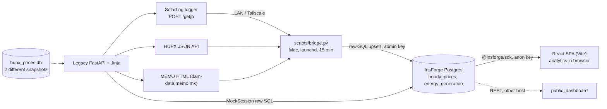

# 17 — Engineering Onboarding Completion Report (2026-11-03)

Point-in-time report required by the onboarding brief (**updated 2026-11-03 23:xx with the live InsForge results and the owner's scope decisions**). Facts are tagged **[V]** verified · **[I]** inferred · **[U]** unknown; evidence is in [16](16_ONBOARDING_VERIFICATION_LEDGER.md), the risk register in [13](13_KNOWN_LIMITATIONS_AND_RISKS.md). Nothing in the repository's source, databases, infrastructure or git state was changed.

## A. Product understanding
ZojaLog (repo `SolarLog`, README "Solar Earnings Tracker", React brand "SolarLogZOJA") is a single-owner monitoring and valuation tool for **one solar plant**. It answers, per hour / day / month: *how many kWh were produced, what was the wholesale day-ahead price (EUR/MWh) at those hours, and what is that energy worth at spot*. Two price benchmarks are offered: **HUPX** (Hungary, default) and **MEMO** (North Macedonia). Revenue is an **estimate** (no tariff, fees, imbalance or curtailment) [V]. User: the owner-operator in Skopje; the dashboard is read-only and unauthenticated [V].

## B. System architecture
Three coexisting paths [V]:

**Production** = bridge → InsForge → React (React never calls FastAPI). **Legacy** = `app/` FastAPI + Jinja UI. **GitHub `origin/main`** is an *older, different* codebase (flat `app/`, SQLite, Bootstrap) [V].

## C. Data flow (one bridge cycle) [V]
1. Every 15 min `run_cycle`: read `max(date)` of each table; energy days = {today, yesterday} (+ up to 14 days if the latest date lags, 7 if empty).
2. `SolarLogFetcher.fetch_day(days_back)` → `POST /getjp {"776":{"<n>":null}}`; intervals `[time, [[power_W, yield_Wh] per channel]]` → `calculate_hourly_energy` → 24 buckets `H1…H24` (kWh) → upsert `ON CONFLICT (date,hour)`.
3. Prices: today (+ gap days, + tomorrow after 13:00): HUPX GET and MEMO POST → upsert `ON CONFLICT (date,hour,source)`.
4. Browser: `insforge.database.from(...).select().eq/gte/lte` → `useMemo` computes revenue/KPIs → Chart.js + tables; auto-refresh every 5 min.
Failure behaviour: scrapers/fetchers return `[]` and log; nothing is written; the UI shows zeros/stale data without warning [V] (R-D5, R-O2).

## D. Backend
- **Bridge (`scripts/bridge.py`, 546 lines):** `InsForgeClient`, `SolarLogFetcher` (candidate discovery, `.device_cache`, Tailscale auto-start), `HUPXScraper`, `MEMOScraper`, `calculate_hourly_energy`, `run_cycle`, `main`. No `app.*` imports.
- **Legacy FastAPI (`app/main.py`, 27 routes, 3 UI):** analysis endpoints `/api/analysis/by-date/{d}` and `/by-month/{ym}` are the only ones with in-repo consumers; three debug routes write fabricated rows (never call). Three startup loops (R-B1). `EnergyDataService` (hardware client), `ScraperFactory` (`hupx|memo|example`), `MockSession`/`insforge_client.py` (fake SQLAlchemy over raw SQL; global session; non-persisting updates; interpolated SQL) [V]. Details: [03](03_BACKEND_AND_API.md), [06](06_HARDWARE_AND_DATA_COLLECTION.md), [07](07_SCRAPERS_AND_PRICE_SOURCES.md).

## E. Frontend
| UI | Pages / interactions | Data |
|---|---|---|
| **React SPA** `frontend/src/App.jsx` | Daily (24-row table, 4 KPIs, combo/bar/line chart) and Monthly (per-day rows, 4 KPIs, revenue bars + MWh line); date/month ◀▶, source HUPX/MEMO, Refresh, month row → daily drill-down, 5-min auto-refresh | InsForge via SDK |
| Legacy Jinja `/ui`, `/ui/daily`, `/ui/monthly` | hero strip of today's totals; date/month inputs, source All/HUPX/MEMO, Load; area/bar/line charts | `GET /api/analysis/*` |
| `frontend/public_dashboard/index.html` | standalone vanilla-JS copy of the dashboard, other InsForge host, `limit` 50/1000 | InsForge REST |
Feature → code map with line anchors: [09](09_APPLICATION_FEATURES_AND_WORKFLOWS.md) (all anchors re-verified).

## F. Design
Light theme; brand `#0aaf72`; surfaces `#f4f6f9`/`#fff`; ink `#0f1623`; accents indigo `#6366f1`, amber `#d97706`, blue `#2563eb`, teal `#0d9488`, rose `#e11d48`; Inter (UI) + JetBrains Mono (hours, numbers, ticks); radii 6–24 px, 4-pt spacing scale, page width 1280 px, sticky translucent nav. ~90 `sl-*` component classes plus `btn-*`, `chart-toggle`, `td-*`; page anatomy header → controls → KPI grid → chart card → table card. States: spinner (loading), `sl-alert--error`, `ErrorBoundary`; **no empty/stale state in React** (zeros look real). Hover 12 / focus 2 rules, none for `:active`/`:disabled`; breakpoints 1024/768/480. `styles.css` exists in two byte-identical copies (keep in sync). `DESIGN.md` (Mintlify, `#18E299`, Geist Mono) is **not** the shipped design; the legacy charts still use its dark palette (R-F10) [V]. Rules for new UI: [08 §6](08_FRONTEND_AND_DESIGN_SYSTEM.md).

## G. Business logic
- Hour label `Hn`: **H1 = 00:00–01:00 local**, H24 = 23:00–24:00; energy rows in **kWh**, prices **EUR/MWh**.
- Energy = per-channel cumulative-yield (Wh) deltas between consecutive samples, bucketed into `H{sample_hour+1}`; first sample is only a baseline; counter reset ⇒ mean power × elapsed (bridge) or 0 for the whole interval (legacy) [V].
- **Revenue(hour) = kWh/1000 × price**; day/month = sums. Missing price ⇒ 0 everywhere; negative prices give negative revenue [V].
- "Avg. price" has three meanings (React: producing hours; legacy: hours with energy *or* price; public: hours with price>0); monthly averages are unweighted although React labels them "Weighted" [V]. Any new KPI must state its definition.
- Open: timestamp semantics (start vs end of interval) and the one-sample-per-hour boundary shift (R-D10) [U]; historical label eras and spikes (R-D13, R-D14).

## H. Database
Production: InsForge Postgres, `hourly_prices(date,hour,price,source; PK date,hour,source)` and `energy_generation(date,hour,energy_kwh; PK date,hour)`, RLS on, permissive policies, no `id`, no timestamps [V as file; live state U]. Legacy SQLite: **two different files** (working-tree 2026-04-01→08-28; HEAD-committed 2025-01-22→2026-04-15 with `H0` labels, no UNIQUE on prices, anomalies) — **not in production**: live InsForge starts at **2026-04-01** (verified by owner-run read-only `GET`s) and has no `H0` rows or spikes; the older history is deliberately ignored (owner decision 2026-11-03, no migration; R-O7). Integrity mechanisms: composite PKs, idempotent upserts, empty-response guard; **none** for DST 23/25-hour days, outliers, missing prices, audit trail or backups [V].

## I. External integrations
SolarLog logger (HTTP, LAN + Tailscale; plain HTTP) · Tailscale CLI/daemon (auto-start) · HUPX Labs JSON API (`ProductH` `'3B'` on DST fall-back breaks the bridge for that day) · MEMO HTML POST (table index 2; column by `DD.MM.YYYY`) · InsForge (REST, raw-SQL, SDK) · Vercel (config file only, deployment [U]) · GitHub (public repo). Infra: [10](10_INFRASTRUCTURE_AND_OPERATIONS.md).

## J. Development readiness — where to implement what
| Change | Place | Check first |
|---|---|---|
| New KPI / chart | `App.jsx` `useMemo` + `sl-*` markup | [05 §7](05_SOLAR_DOMAIN_AND_CALCULATIONS.md), [08 §6](08_FRONTEND_AND_DESIGN_SYSTEM.md), mirror in `public_dashboard`/`main.py` only if needed |
| Energy/revenue rule | `bridge.py::calculate_hourly_energy` (production) | [05 §9](05_SOLAR_DOMAIN_AND_CALCULATIONS.md); bridge rewrites today/yesterday and ≤14-day gaps |
| New price source | bridge scraper class + UI selectors (+ `ScraperFactory` if legacy matters) | [07 §5](07_SCRAPERS_AND_PRICE_SOURCES.md) |
| DB change | verify live schema first; then `bridge.upsert`, React `select('*')`, `public_dashboard`, MockSession | [04 §7](04_DATABASE_AND_DATA_INTEGRITY.md) |
| Fix DST `'3B'` | `bridge.py` L334 (+ `hupx_scraper.py` L207) | R-D3; backfill needs approval |
Workflow, validation commands and report format: [CLAUDE.md](../../CLAUDE.md), [12](12_TESTING_AND_VALIDATION.md). There is **no automated test suite**; extract pure functions (`calculate_hourly_energy`, the `useMemo` maths) before changing them.

## K. Knowledge system (repository)
`CLAUDE.md` (entry point) · `docs/zojalog/PROJECT_CONTEXT_INDEX.md` (34-topic map) · `01` overview · `02` architecture/data flow (+ import graph) · `03` backend/API · `04` database/integrity · `05` solar domain/calculations · `06` hardware/collection · `07` scrapers · `08` frontend/design · `09` feature→code map · `10` infrastructure · `11` security/config · `12` testing/validation · `13` risks & questions · `14` ADRs (001–011) · `15` changelog (incl. legacy-doc review) · `16` verification ledger · `17` this report. Files changed in the second pass: [15 §A](15_CHANGELOG.md). Project Knowledge copies are mirrors and must be refreshed for every changed file (ADR-011).

## L. Unresolved questions
See [13 §H](13_KNOWN_LIMITATIONS_AND_RISKS.md) (Q-01…Q-17) and [16 §8](16_ONBOARDING_VERIFICATION_LEDGER.md). Highest value: live InsForge schema/RLS/grants (`zojalog_schema_check.sql` not yet run; can `anon` write?); SolarLog timestamp semantics; negative-price policy; which tree is canonical; fate of the FastAPI app.

## M. Risks and critical constraints
Highest first: **R-O1** — the refactor is unpushed/uncommitted (pre-2026-04 history is out of scope, R-O7 accepted); **R-D3** DST day loses all HUPX prices (**confirmed live: 0 HUPX rows for 2026-10-25**); R-D13/R-D14/R-D15 exist only in the old SQLite, not in production, but the *mechanisms* (no outlier guard, no label guard) remain ingestion risks; **R-D5** missing price = 0; **R-D14** spikes; **R-S1/R-S2** unauthenticated debug writers and SQL injection *if the FastAPI app is reachable*; **R-S3** RLS write policy unscoped [U]; **R-D8/R-D9** bridge overwrites recent days and never refills interior gaps; **R-F1** day navigation bug under UTC+; business logic duplicated in 4 places (change together or not at all).

## N. Future ingestion rules — candidate list (owner decision pending; **no code written**)
Scope per owner (2026-11-03): ignore old SQLite history; touch as little as possible; focus on rules for data the bridge ingests *from now on*. Candidates, each tied to evidence — none is implemented:
1. **DST-tolerant HUPX parsing** — `ProductH` like `'3B'` currently drops the whole day (R-D3; confirmed live for 2026-10-25). Next transitions: 2027-03-28 (23 h), 2027-10-31 (25 h). Needs a policy for 23/25-hour days vs the `H1…H24` schema (R-D11, Q-08).
2. **Label guard** — accept only `H1…H24`; never write `H0`/`H25` (R-D13 mechanism).
3. **Plausibility check on hourly energy** — flag/log values far above the observed maximum (546 kWh/h) or at night; never silently clamp (R-D14 mechanism; the bridge books a sample gap into one hour).
4. **Missing vs zero price** — decide what a missing/failed price is (today: 0, silently understates revenue, R-D5) and what a real negative price means for revenue (Q-15).
5. **Interior-gap backfill** — only `max(date)` is compared, so holes older than yesterday are never refilled (R-D9); the backfill path has never fired in the log.
6. **Overwrite policy** — the bridge rewrites today/yesterday and ≤14-day gaps with the device's current view (R-D8).
7. **Scraper failure visibility** — failures are logged only; the UI cannot tell "no data" from "failed" (R-O2, R-F12).
Every item needs an agreed plan first (CLAUDE.md workflow); items 1–3 change what is written to production, so they need dry-run/fixture validation before any live run.

---
## ZOJALOG ENGINEERING ONBOARDING — COMPLETION REPORT
**Honest assessment.** I can explain the system end to end and point to the code for every visible feature; the documentation I inherited held up under independent checking, and I added evidence-backed corrections and new findings. That is **not** "100 % understanding":
- **Verified by reading source/running read-only checks (high confidence):** bridge algorithm and cycle, FastAPI routes and maths, MockSession behaviour, React logic and anchors, CSS tokens/classes, legacy UI, SQLite snapshots, bridge log statistics, import graph, GitHub-vs-working-tree differences, git topology, library behaviours.
- **Inferred (medium):** causes of spikes/label eras, revenue effect of the label shift, plant specifics from README.
- **Verified live (owner-run, anon `GET`s, 2026-11-03):** production coverage 2026-04-01→2026-11-03, no `H0` rows, no spikes (max 546.4 kWh), HUPX 2026-10-25 absent.
- **Not verifiable without outside access (unknown):** live InsForge schema/RLS/grants, real SolarLog payloads and timestamp semantics, browser rendering, launchd plist, deployments, untracked env contents.
- **Not done by design:** no code, DB, infra or git changes; no commits/pushes; no scraper or endpoint calls.
